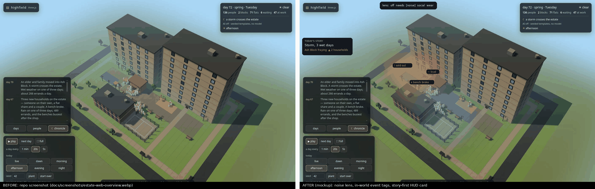

# Observability and visuals → reading a watched estate

Proposals for making emergent behaviour easy to read and explain. Part of
the [November 2026 review](review-2026-11-roadmap.md), see also
[emergent mechanics](emergent-mechanics.md) and
[research tooling](research-tooling.md).

Everything below is **proposed** unless it is marked as observed.

*The mockup is drawn over `docs/screenshots/estate-web-overview.webp`. It
is illustrative only and not built.*

---

## 1. Observed today

- The HUD has a title, a day/weather/population box, a
  chronicle/people/days feed, pace and phase controls, and a
  click-to-inspect card (`page3d/estate/index.html`, `hud.js`).
- Type is the system UI font, with an amber `--lamp` accent and 11–12 px
  dim text in several places (`page3d/estate/style.css`).
- Need glyphs exist in `rules.json` (`needs.*.glyph`).
- The chooser's ranked needs are observable through `HOOKS` in
  `src/sim/engine/residents.ts`.

---

## 2. Ranked recommendations

| Rank | Id | Recommendation | Why, for a researcher | Effort | Impact |
|---|---|---|---|---|---|
| 1 | V10 | **Why-log**: per resident per phase, the top ranked needs, the candidates and the winning pick, shown on the card | Turns emergent behaviour into an explanation; the data already passes through `pressure` / `HOOKS` | M | High |
| 2 | V11 | **Follow-a-resident**: the camera tracks one person, with a strip showing their day, their needs over time and their friendships | Watching one person is the classic way to read a sim (Dwarf Fortress, RimWorld) | M | High |
| 3 | V1 | **Lenses**: needs / noise / social / wear as a soft ground heatmap | Shows the spatial fields that drive choices (cf. the Cities: Skylines overlays) | M | High |
| 4 | V2 | **In-world event tags** (sold out, bench broke, power out, loud) that fade after a phase | Ties each chronicle fact to its place | S | High |
| 5 | V9 | **Timeline scrubber** over the kept day books, with markers for events | Arc review; scrubbing view-only history fits what the runner keeps. Full replay is speculative (see [tooling](research-tooling.md)) | M | High |
| 6 | V4 | Crowd spacing and activity poses (sit, play, queue, chat in pairs) | You can't read behaviour from blobs | M | Med |
| 7 | V3 | Story-first HUD: what's changing and who's fraying, with totals second | Points the observer at the signal | S | Med |
| 8 | V8 | Accessibility: no meaning in colour alone, colour-blind-safe lens ramps, reduced motion, AA contrast on dim text, keyboard focus on tabs, `aria-live` for story events | Lenses depend on it | S | Med |
| 9 | V6 | Art direction: state shown in materials (wet slate, grime and cracks, taped and tilted broken fixtures) | Ambient legibility; matches research step 12 | M | Med |
| 10 | V7 | Juice and motion (pulse when a need is met, lights coming on, puddle ripples) | Demoted: nice to have, not explanatory | S–M | Low |
| — | V5 | Need glyphs over people | Folded into V10 and V11 | S | — |

---

## 3. Constraints

- `tests/vendor.test.ts` fails on any page3d difference except the
  `world.js` fork. HUD work (V2, V3, V8, V10) needs that fork extended,
  which is an open question in the roadmap.
- Views must only read state. Nothing here may draw from the sim's RNG
  channels.
